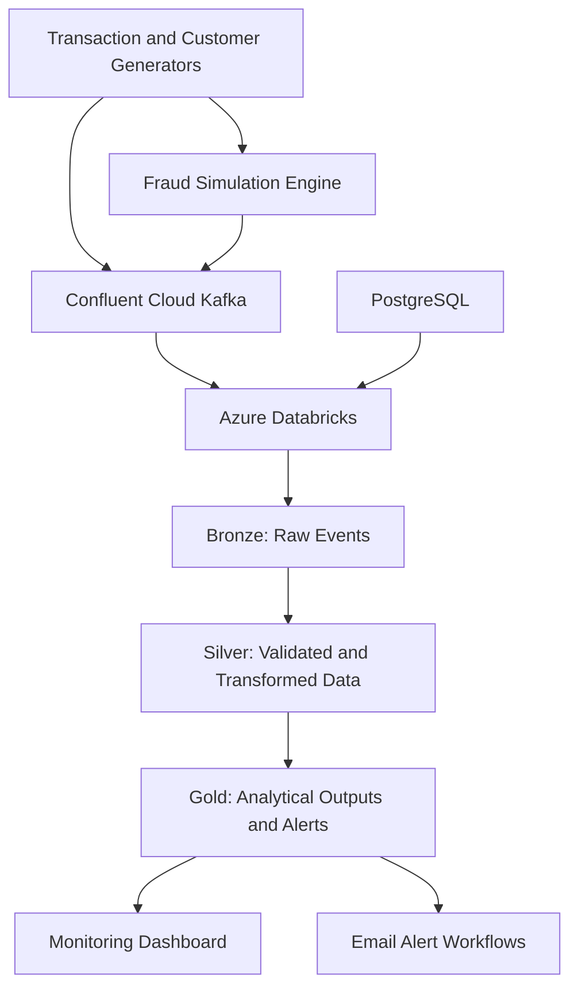

# FinGuard — Real-Time Fraud Monitoring Data Platform

A streaming data engineering project that simulates credit-card transactions, publishes events to Apache Kafka, processes transaction streams in Azure Databricks, and supports fraud monitoring through analytical outputs and alerting workflows.

**Core technologies:** Python · Confluent Cloud Kafka · Azure Databricks · Spark Structured Streaming · Delta Lake · PostgreSQL · SQL

## Overview

FinGuard demonstrates how a streaming data platform can ingest transaction events, preserve raw event data, apply data transformation and enrichment, and produce analytical outputs for fraud monitoring.

The project combines event generation, Kafka-based ingestion, Databricks processing pipelines, SQL-based data management, and a dashboard for monitoring.

This is a portfolio engineering project, not a claim of a certified production fraud prevention system.

## Architecture



*Architecture overview. Confirm the exact data flow and dependencies against the implementation before treating every connection in this diagram as deployed.*

## Project Components

### 1. Kafka transaction producers

Located in `kafka_producer/`.

- Generates synthetic customers, merchants, and transactions.
- Publishes normal and simulated fraudulent transaction events.
- Uses configurable transaction generation and fraud simulation settings.
- Separates producer logic, data models, generators, and utility functions.

### 2. Databricks streaming pipelines

Located in `databricks notebooks and pipelines/finguard_project/`.

- Kafka streaming connectivity and ingestion experiments.
- Bronze-layer transaction and watchlist ingestion.
- Silver-layer transformation pipelines.
- Gold-layer transaction aggregation and fraud alert logic.
- Supporting alert notification and ingestion notebooks.

The Bronze/Silver/Gold structure separates raw ingestion, transformation, and downstream analytical processing.

### 3. PostgreSQL and SQL

Located in `postgres sql/`.

Contains SQL scripts for historical and incremental customer data workflows. Review the scripts for the intended schema, source tables, and incremental processing logic before deployment.

### 4. Monitoring dashboard

Located in `dashboard/`.

Contains the FinGuard fraud monitoring dashboard definition. Dashboard functionality depends on the configured data sources and the environment in which it is deployed.

## Data Flow

1. **Generate:** Python components create synthetic transaction and reference data.
2. **Publish:** Kafka producers send events to the configured Kafka topic.
3. **Ingest:** Databricks reads transaction events from Kafka.
4. **Transform:** Bronze and Silver pipelines preserve and process incoming data.
5. **Analyze:** Gold pipelines calculate transaction metrics and apply implemented alert rules.
6. **Monitor:** Dashboard and notification components expose selected metrics and alert outputs.

## Repository Structure

```text
finguard-realtime-streaming/
├── dashboard/
├── databricks notebooks and pipelines/
│   └── finguard_project/
│       ├── finguard_streaming/
│       │   ├── bronze/
│       │   ├── silver/
│       │   ├── gold/
│       │   └── alert/
│       └── fraud_watchlist_file_generator/
├── kafka_producer/
│   ├── config.py
│   ├── consumer.py
│   ├── fraud_engine.py
│   ├── models.py
│   ├── producer_normal.py
│   ├── producer_fraud_card.py
│   ├── producer_fraud_transaction.py
│   ├── transaction_generator.py
│   ├── requirements.txt
│   └── README.md
├── postgres sql/
└── README.md
```

## Setup

### Prerequisites

- Python version compatible with `kafka_producer/requirements.txt`
- Access to a configured Kafka cluster
- Azure Databricks workspace with the required pipeline permissions
- PostgreSQL, if using the SQL component
- Appropriate access to the dashboard's configured data sources

### 1. Configure the Kafka producer

Open a terminal in the producer directory:

```powershell
cd kafka_producer
python -m venv .venv
.\.venv\Scripts\Activate.ps1
pip install -r requirements.txt
```

Create a local `.env` file using `.env.example` as a template. Populate it with your own Kafka connection details and topic configuration.

**Never commit `.env` or real credentials to GitHub.** Store Databricks credentials using an approved secret-management mechanism.

### 2. Configure Databricks

Import or deploy the relevant pipeline files into your Databricks workspace. Configure Kafka connectivity, secret access, catalog and schema names, pipeline settings, and checkpoint locations for your environment.

The exact deployment procedure depends on the workspace configuration.

### 3. Run and validate

Start the producer using the entry point appropriate to the selected scenario. Verify that events reach Kafka, the Databricks pipeline processes them, and downstream tables and alert outputs contain the expected results.

Consult the component-specific documentation for the correct execution order.

## Engineering Considerations

Areas to validate and document as part of the project include:

- Secure credential management
- Streaming checkpointing and recovery
- Event-time processing and late-arriving events
- Data validation and quality checks
- Duplicate handling and idempotent writes
- Error handling, retries, and alert delivery
- Pipeline observability and operational troubleshooting

Only mark these capabilities as implemented after verifying them in code and testing.

## Limitations

- Transactions and fraud scenarios are simulated rather than sourced from a real payment network.
- Fraud rules and alert thresholds require validation before any real-world application.
- Deployment and operating costs depend on the cloud resources and service configuration.
- This project is intended for learning, demonstration, and portfolio evaluation.

## Future Improvements

- Automated unit and data-quality tests
- Reproducible deployment configuration
- Streaming latency and throughput measurements
- Documented recovery and replay procedures
- CI checks and automated deployment workflows
- Screenshots and reproducible evidence of pipeline execution

## Author

**Isaiah Nyakundi**

GitHub: [@viradidi](https://github.com/viradidi)

Project repository: [FinGuard Real-Time Streaming](https://github.com/viradidi/finguard-realtime-streaming)